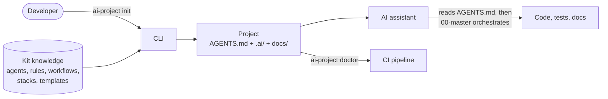

# AI Software Engineering Kit

Start projects that AI coding assistants develop **like a disciplined engineering team**:
understanding before coding, designing before implementing, testing, reviewing security,
and documenting, following the team's standards.

> 🇪🇸 **¿No eres desarrollador?** Empieza por la
> [Guía del equipo (español, paso a paso)](docs/GUIA_EQUIPO.md).
>
> 🧩 **Using Claude Code?** Install the
> [NETSF AI Software Engineering plugin](plugins/netsf-ai-software-engineering/README.md)
> (`/plugin install netsf-ai-software-engineering@netsf`).

```bash
pip install "git+https://git.netsf.fr/<group>/ai-software-engineering-kit.git"
ai-project init
```

One command gives your project:

- `AGENTS.md`: the single entry point every AI assistant reads (Claude Code, Codex, Cursor,
  Copilot...).
- `.ai/agents/`: 15 specialised roles (backend, security, testing...) coordinated by a
  master agent, plus a context optimizer that is never loaded by default.
- **Context routing**: each task loads only the agents, rule sections and stack guides it needs
  (`ai-project context --task "..."`). A local **knowledge graph** (derived, regenerable JSON),
  task classification, ranking and budget tiers pick the context. The measured reference tasks
  load 67–76% less *estimated* context than loading everything.
- `.ai/rules/`, `.ai/workflows/`, `.ai/stacks/`: engineering rules with citable IDs,
  step-by-step workflows, and technology guidance.
- `.ai/context/project.md`: what your project is, which the AI reads first.
- A docs skeleton with ADRs and Mermaid diagrams, plus `ai-project doctor` to check it all
  in CI.

You do **not** need to understand agent orchestration or prompt engineering to use it.

## Why

AI assistants write code quickly, but on their own they skip design, tests and security,
and they forget decisions between sessions. The kit makes "reliable, secure, maintainable,
documented" the default path: every project ships the same versioned standards, and they
can be updated across projects without losing project-specific changes.

## Installation

Requirements: Python 3.9+ and Git. The CLI has **no runtime dependencies**. It works on
Windows, Linux and macOS.

```bash
# Recommended: isolated install
pipx install "git+https://git.netsf.fr/<group>/ai-software-engineering-kit.git@v1.3.0"

# or with pip (ideally in a virtual environment)
pip install "git+https://git.netsf.fr/<group>/ai-software-engineering-kit.git@v1.3.0"

ai-project version
```

> Replace `<group>` with the group that hosts the kit on git.netsf.fr.
> Kit maintainers: see [docs/CONTRIBUTING.md](docs/CONTRIBUTING.md) for an editable install.

## Quick start

```bash
ai-project init                 # interactive wizard -> ./<project-name>/
cd <project-name>
# 1. complete .ai/context/project.md
# 2. open the project in your AI assistant and ask it to follow .ai/workflows/new-project.md
ai-project doctor               # check the setup
```

Already have a project? Run `ai-project init .` inside it. Existing files are never
overwritten; see [Getting started](docs/GETTING_STARTED.md).

## Commands

| Command | Purpose |
|---|---|
| `ai-project init [DIR]` | Create a project, or add the kit to an existing one |
| `ai-project doctor` | Validate configuration, quality tooling, security, docs (exit 1 on FAIL) |
| `ai-project update` | Refresh kit files to the installed version, keeping your customisations |
| `ai-project context --task "..."` | Minimum context for a task: classification, ranked agents, rule sections, stacks, budget tier, reasons (`--json`, `--rebuild-graph`) |
| `ai-project list [profiles\|technologies\|stacks\|agents...]` | Show what is available |
| `ai-project version` | Show CLI, kit and project versions |
| `ai-project help [command]` | Help |

Full reference: [docs/CLI.md](docs/CLI.md).

## Profiles and technologies

| Profile | For |
|---|---|
| `backend-api` | HTTP APIs (FastAPI, Django, Flask, Node + TypeScript) |
| `frontend` | SPAs (React, Angular) |
| `fullstack` | React or Angular frontend + Python backend |
| `python-automation` | Scripts, scheduled jobs, integrations |
| `data-engineering` | Ingestion and transformation pipelines |
| `microservice` | One independently deployable service |
| `custom` | Everything else: all agents, you pick the stack guides |

Databases: PostgreSQL, SQL Server, ClickHouse, MongoDB. Infrastructure: Docker,
Kubernetes (RKE Staging and Prod), NGINX + uWSGI, Linux, CI/CD.
Details: [docs/PROFILES_AND_STACKS.md](docs/PROFILES_AND_STACKS.md).

## How it works



Files in a generated project are either **CORE**, which the kit manages and `update` refreshes, or
**project-owned**, which you own and the kit never touches. Put your own instructions in `.ai/custom/`.
Read more in [docs/ARCHITECTURE.md](docs/ARCHITECTURE.md) and
[docs/CUSTOMIZATION.md](docs/CUSTOMIZATION.md).

## Example

[examples/fastapi-demo](examples/fastapi-demo) was generated with the CLI and then built by
following the kit workflows. It includes a layered FastAPI app, 20 tests, ADRs, diagrams, a
non-root Dockerfile, Kubernetes manifests and a CI pipeline.

## Documentation

| Topic | Document |
|---|---|
| Guía del equipo (español, no desarrolladores) | [docs/GUIA_EQUIPO.md](docs/GUIA_EQUIPO.md) |
| Claude Code plugin (NETSF AI Software Engineering) | [plugins/netsf-ai-software-engineering/README.md](plugins/netsf-ai-software-engineering/README.md) |
| First project, step by step | [docs/GETTING_STARTED.md](docs/GETTING_STARTED.md) |
| CLI reference | [docs/CLI.md](docs/CLI.md) |
| Agents and how they interact | [docs/AGENTS.md](docs/AGENTS.md) |
| Context & token optimization | [docs/CONTEXT_OPTIMIZATION.md](docs/CONTEXT_OPTIMIZATION.md) |
| Profiles, technologies, stacks | [docs/PROFILES_AND_STACKS.md](docs/PROFILES_AND_STACKS.md) |
| Customising (projects and the kit) | [docs/CUSTOMIZATION.md](docs/CUSTOMIZATION.md) |
| Versioning and updating | [docs/VERSIONING.md](docs/VERSIONING.md) |
| Architecture of the kit | [docs/ARCHITECTURE.md](docs/ARCHITECTURE.md) |
| Security | [docs/SECURITY.md](docs/SECURITY.md) |
| Troubleshooting | [docs/TROUBLESHOOTING.md](docs/TROUBLESHOOTING.md) |
| Contributing | [docs/CONTRIBUTING.md](docs/CONTRIBUTING.md) |

## Security notice

The kit enforces a team policy: **no real credentials in `.env` files**. `doctor` prints
a prominent warning when it finds them and recommends Kubernetes Secrets (Sealed or External
Secrets), a vault, or CI masked variables. See [docs/SECURITY.md](docs/SECURITY.md).

## License

Internal use, see [LICENSE](LICENSE). Changes: [CHANGELOG.md](CHANGELOG.md).
