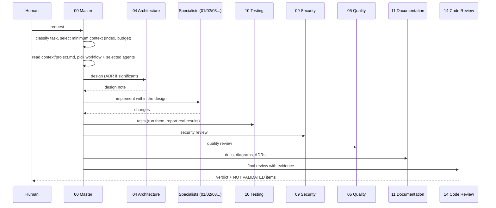

# Agents

Agents are **roles described in Markdown**, not running programs. An AI assistant reads the
role file and acts accordingly. Assistants with sub-agents (such as Claude Code) can delegate
each role to a sub-agent. Others play the roles one after another ("single-assistant mode",
described in `agents/00-master.md`). Because roles are plain files, they work with any
assistant.

## The roster

| File | Role | Typical trigger |
|---|---|---|
| `00-master.md` | Orchestrator: analyses the request, picks workflow and agents, resolves conflicts, runs final review | Every task |
| `01-frontend.md` | UI architecture, components, accessibility, state, forms, UX states | Pages, components |
| `02-backend.md` | API design, layering, validation, auth, errors, integrations, jobs | Endpoints, business logic |
| `03-database.md` | Schema, indexes, migrations, queries, transactions, N+1 detection | Data model, queries |
| `04-architecture.md` | Proportional architecture, boundaries, ADRs | New modules, structural changes |
| `05-quality.md` | Readability, naming, duplication, complexity | Every change |
| `06-solid-patterns.md` | SOLID, design patterns (only when they earn their place) | Design, refactoring |
| `07-oop.md` | Encapsulation, composition over inheritance | Class design |
| `08-performance.md` | Measure, then optimise, then measure again | Performance issues, budgets |
| `09-security.md` | Secure by design, OWASP, secrets and `.env` policy | Every change touching input, auth, data, deps |
| `10-testing.md` | Test strategy and meaningful tests | Every change |
| `11-documentation.md` | README, architecture docs, ADRs, Mermaid diagrams | Every behaviour change |
| `12-devops.md` | CI/CD, Docker, Kubernetes (RKE), releases, rollback | Pipelines, deployment |
| `13-observability.md` | Logs, metrics, traces, probes, alerts | Services in production |
| `14-code-review.md` | Final evidence-based review, verdict APPROVE / REQUEST CHANGES | End of every task |
| `15-context-token-optimizer.md` | Context-optimisation specialist: routing, graph, ranking and budget tuning, metrics | Only for tasks about context optimisation or routing |

Each file has the same sections: Role, Objective, Responsibilities, Rules, Inputs, Outputs,
Validation, Forbidden behavior, Collaboration with other agents.

**Not every agent is loaded for every task.** Context selection is programmatic:
`ai-project context` classifies the task, walks the local knowledge graph, ranks candidates
(REQUIRED / RECOMMENDED / OPTIONAL) and fits them in a budget tier. The master agent receives
that package rather than reading every agent (lazy loading, levels L0–L3, rule slices,
deduplication): see
[CONTEXT_OPTIMIZATION.md](CONTEXT_OPTIMIZATION.md). Security, performance, observability and
code review are "deep review" agents. They are loaded in full only when the task is about
them; otherwise a targeted review applies the matching rule sections.

A project only receives the agents its profile needs (for example, no frontend agent in a
backend API). `03-database.md` is added automatically when a database is selected.

## How they interact

**Conflicts** between agents, for example performance against readability, are resolved by
the master in this order: security, then correctness and data integrity, then accepted ADRs,
then maintainability, then performance, then convenience. Anything still ambiguous becomes
an ADR or a question to the human.

## Rules, workflows and stacks

- **Rules** (`rules/*.md`) are the "what": numbered, citable requirements (`SEC-07`,
  `TEST-03`...) using MUST, SHOULD and MAY.
- **Workflows** (`workflows/*.md`) are the "how": ordered steps, each naming the responsible
  agent and its output, with exit criteria.
- **Stacks** (`stacks/<tech>/README.md`) add technology-specific tooling, conventions and
  pitfalls. Generic rules stay in `rules/`.

All paths inside these files are relative to `.ai/` in a generated project.
