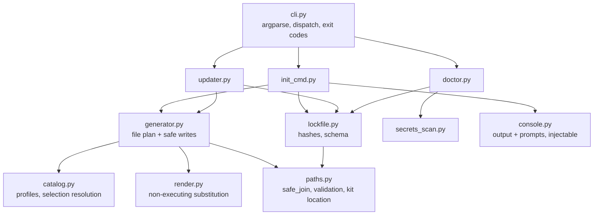
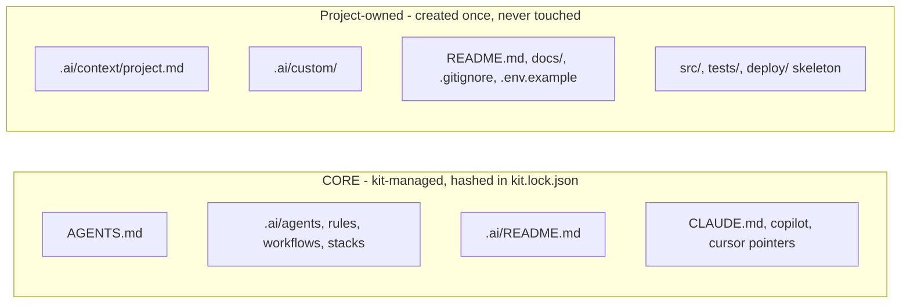
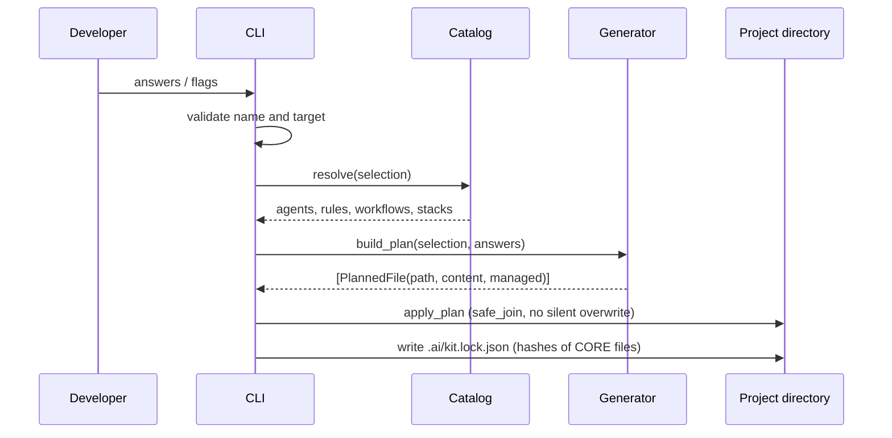

# Architecture of the kit

## Design goals

1. **Knowledge is data**: agents, rules, workflows, stacks, profiles and templates are
   Markdown and JSON. Most changes to the kit need no code.
2. **Vendor-neutral**: one knowledge base and one entry point (`AGENTS.md`). Assistant
   integrations are thin pointer files.
3. **Safe by construction**: no code execution from templates, no network access, every
   written path validated, and existing files never silently overwritten.
4. **Updatable**: projects receive kit improvements without losing their customisations.
5. **Small**: standard-library Python (about 2,300 lines including docstrings), with no runtime dependencies.

## Repository layout

```text
ai-software-engineering-kit/
├── cli/ai_project/        # the CLI (Python package)
├── agents/                # 15 agent roles               ┐
├── rules/                 # 6 rule sets                  │ copied verbatim into
├── workflows/             # 6 workflows                  │ <project>/.ai/
├── stacks/<tech>/         # 18 stack guides              ┘
├── profiles/*.json        # what each project type receives
├── catalog/*.json         # technologies, databases, deployments, assistants, organisation
├── templates/
│   ├── manifest.json      # which template outputs are CORE
│   ├── base/              # AGENTS.md, .ai/README.md, context, docs skeleton, dotfiles
│   └── <profile>/         # overlays (architecture docs with relevant diagrams)
├── integrations/<tool>/files/   # CLAUDE.md, copilot-instructions.md, cursor rule
├── examples/fastapi-demo/ # generated with the CLI, then developed
├── tests/                 # tests of the kit itself
└── docs/
```

The wheel bundles the knowledge directories under `ai_project/_kit/` (see `pyproject.toml`).
At runtime the CLI looks for the kit in this order: `$AI_KIT_HOME`, the bundled copy, then
the source checkout.

## CLI modules



| Module | Responsibility |
|---|---|
| `cli.py` | Parse arguments, dispatch, map `KitError` to exit codes. No business logic. |
| `catalog.py` | Load profiles and catalogs; resolve a `Selection` into agents, rules, workflows and stacks; validate choices. |
| `generator.py` | Build the file plan (CORE vs SEED), render templates, write with conflict handling. |
| `render.py` | `{{ variable }}` substitution only, single pass, unknown variable is an error. |
| `lockfile.py` | Read and write `.ai/kit.lock.json`; line-ending-insensitive hashing; SemVer parsing. |
| `updater.py` | Three-way update between the lock base, local files and the new kit. |
| `doctor.py` | Independent checks producing PASS, WARN, FAIL or INFO; text and JSON output. |
| `secrets_scan.py` | Heuristic secret detection and `.env` classification. |
| `paths.py` | Path safety, project-name validation, text sanitising, kit location. |
| `console.py` | Output (colours, ASCII fallback) and prompts (bounded retries). |

Dependencies point one way: commands depend on the generator and lock file, and those depend
on `paths`. `console` and `catalog` are injected, which keeps every command testable in-process.

## Generated project model



`init` writes both kinds. `update` only touches CORE files, and creates project-owned
files that are new in the kit, never recreating ones you deleted.

## Data flow of `init`



## Key decisions

| Decision | Rationale |
|---|---|
| Python, standard library only | Available everywhere in the team, cross-platform, nothing to audit or break |
| JSON for profiles and catalogs | Parsed by the standard library on Python 3.9+ (TOML needs 3.11) |
| Own 30-line renderer instead of Jinja2 | No code execution in templates, no dependency |
| Copy files, not symlinks | Works on Windows without privileges and survives Git |
| Hash the content the kit wrote | A precise three-way merge base, without storing old file contents |
| Hash with LF-normalised content | Git `autocrlf` on Windows does not create false "modifications" |
| Dotfile templates named `dot-*` | A real `.gitignore` under `templates/` would apply to the kit repo itself |
