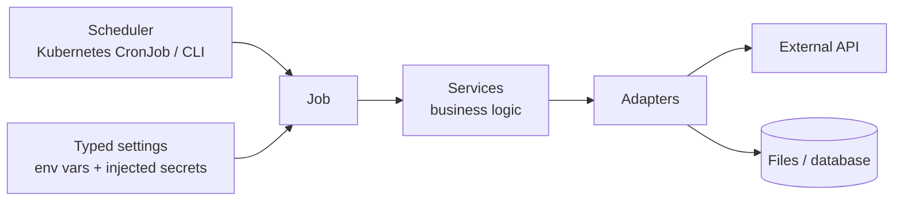
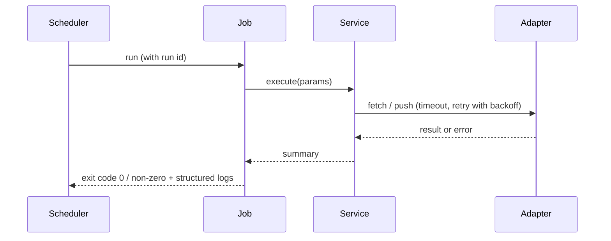

# Architecture — {{ project_name }}

> Project-owned. Keep diagrams in sync with the code (see `.ai/agents/11-documentation.md`).
>
> Scope: database **{{ database_title }}**; deployment **{{ deployment_title }}**.
> Elements marked *(if deployed)* and the Deployment section apply only when deployment is
> in scope. Persistence is added only when the requirements need it and the database has
> been chosen. Remove what does not apply.

## Overview

{{ architecture }}

Jobs are small, idempotent and safe to re-run. External systems are reached only through
adapters, so jobs and services are testable without network access.

## Components

## Execution flow

## Deployment (if deployed)

Packaged as a Docker image, scheduled as a Kubernetes CronJob on RKE Staging, then the
same image is promoted to RKE Prod.

## Decisions

See `docs/adr/`.
