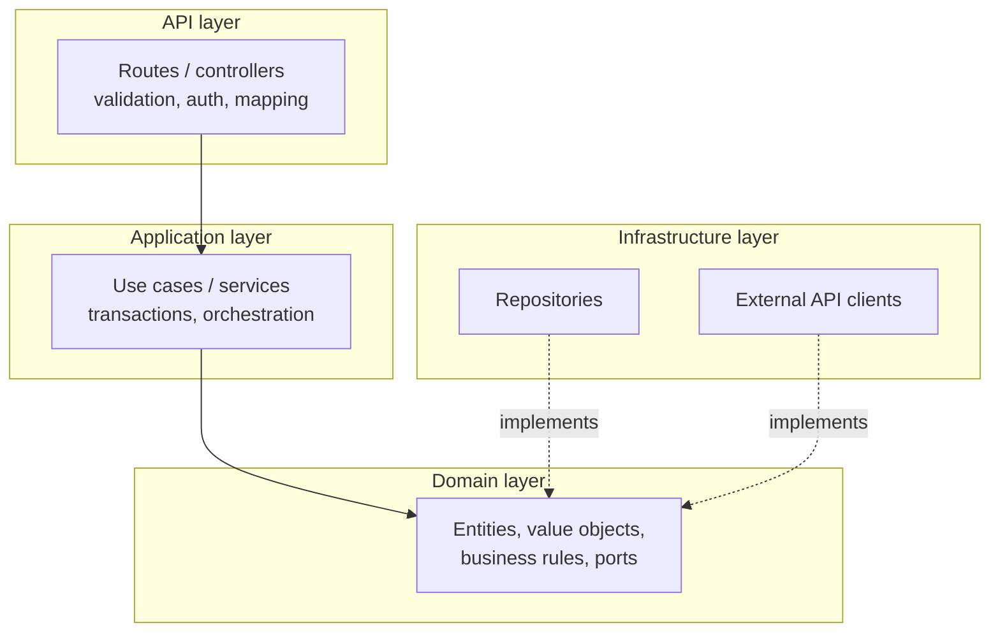
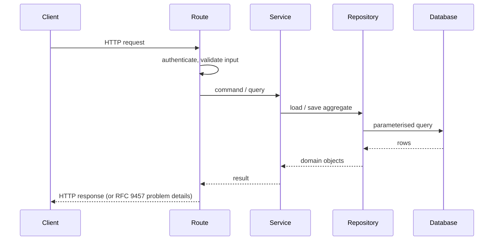

# Architecture — {{ project_name }}

> Project-owned. Keep diagrams in sync with the code (see `.ai/agents/11-documentation.md`).

## Overview

{{ architecture }}

Dependencies point inwards: the domain knows nothing about HTTP, the database or frameworks.

## System architecture

```mermaid
flowchart LR
    client([API clients]) -->|HTTPS| proxy[NGINX]
    proxy --> api[{{ project_name }} API]
    api --> db[("{{ database_title }}")]
    api --> ext[External services]
```

## Components



## Request flow



## Deployment

```mermaid
flowchart LR
    git[{{ org_git_server }}] --> ci[CI pipeline] --> registry[(Image registry)]
    registry --> staging[RKE Staging]
    staging -->|same image, after approval| prod[RKE Prod]
```

## Decisions

See `docs/adr/`.
