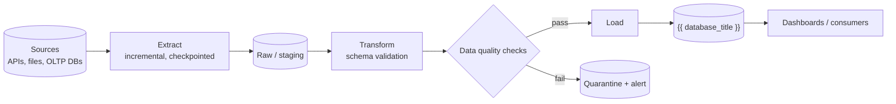
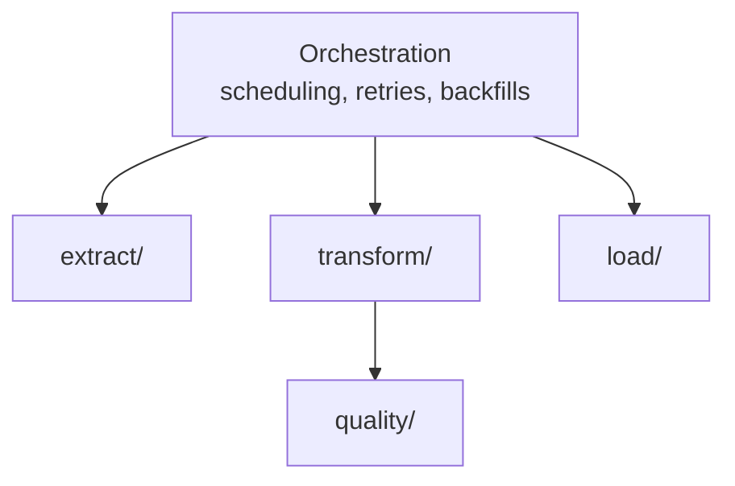
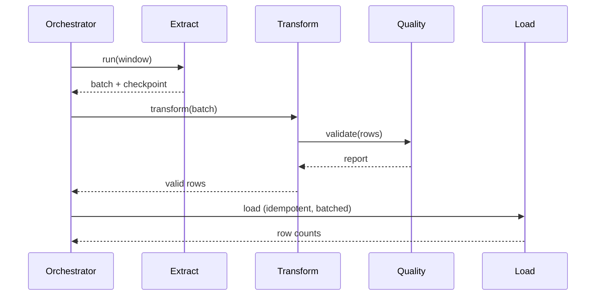

# Architecture — {{ project_name }}

> Project-owned. Keep diagrams in sync with the code (see `.ai/agents/11-documentation.md`).

## Overview

{{ architecture }}

## Data flow

## Components

## Pipeline run

## Deployment

Docker image; jobs run as Kubernetes CronJobs (or an orchestrator) on RKE Staging, then
the same image is promoted to RKE Prod.

## Decisions

See `docs/adr/`.
