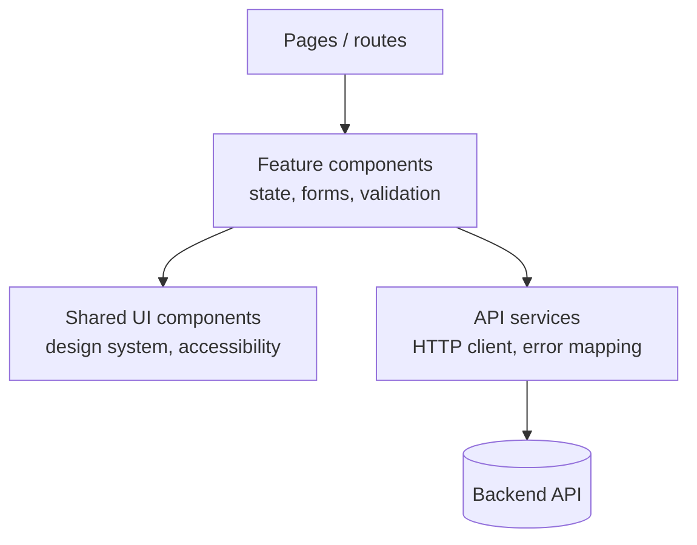
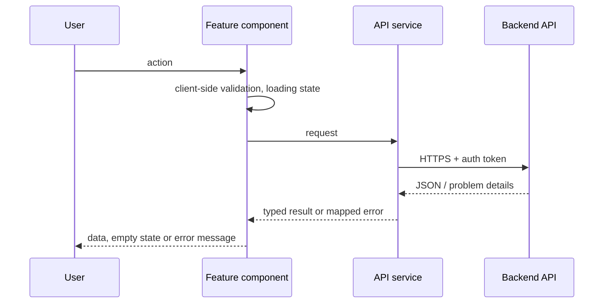

# Architecture — {{ project_name }}

> Project-owned. Keep diagrams in sync with the code (see `.ai/agents/11-documentation.md`).
>
> Scope: database **{{ database_title }}**; deployment **{{ deployment_title }}**.
> Elements marked *(if deployed)* and the Deployment section apply only when deployment is
> in scope. Persistence is added only when the requirements need it and the database has
> been chosen. Remove what does not apply.

## Overview

{{ architecture }}

## System architecture

```mermaid
flowchart LR
    browser([Browser]) -->|HTTPS| nginx[NGINX<br/>(if deployed)<br/>static files + CSP headers]
    browser -->|HTTPS / JSON| api[Backend API]
    browser --> idp[Identity provider]
```

## Components



## Data flow



## Deployment (if deployed)

Static assets built in CI, packaged into an NGINX image and deployed to RKE Staging, then
the same image is promoted to RKE Prod.

## Decisions

See `docs/adr/`.
