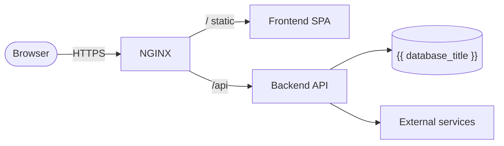
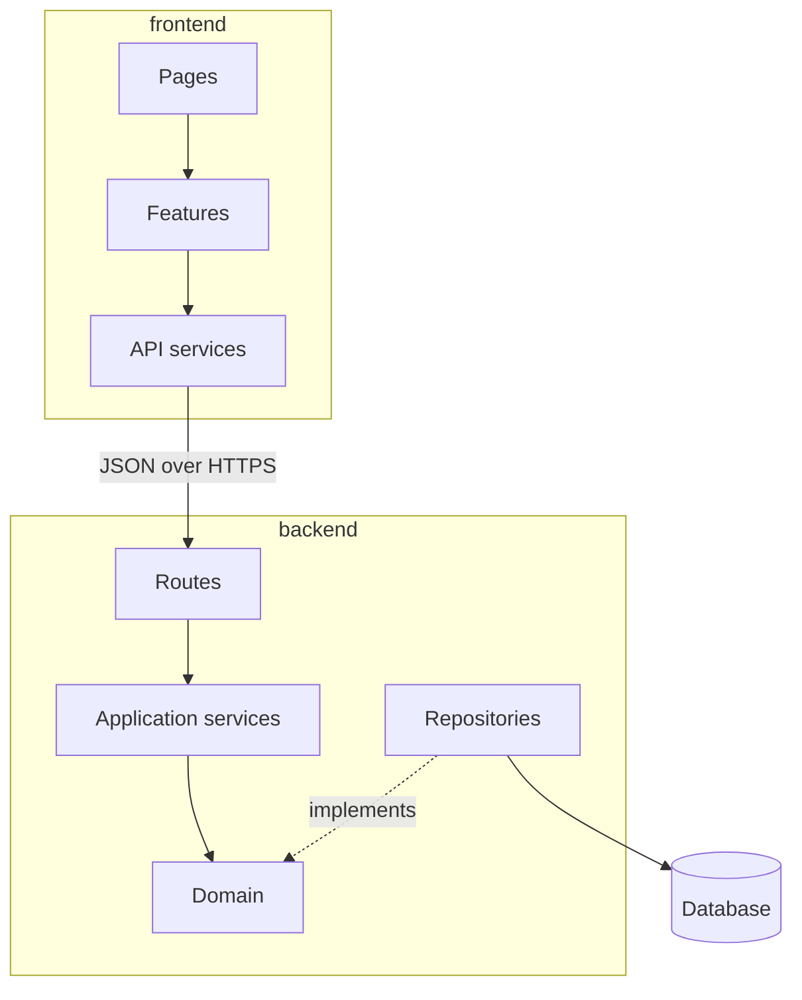
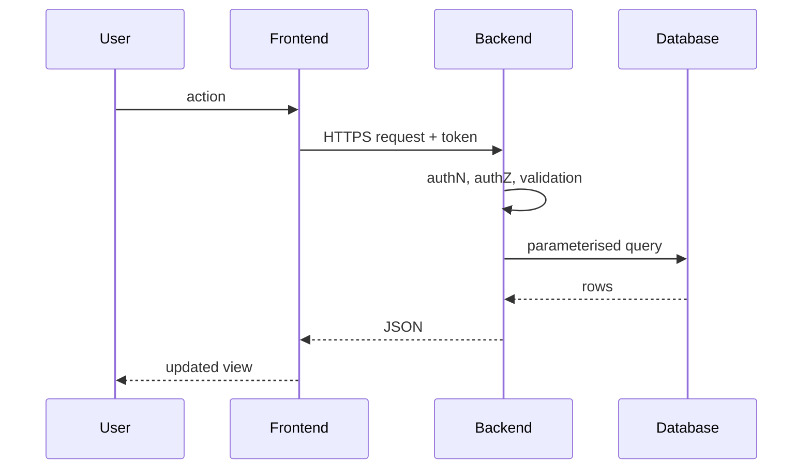

# Architecture — {{ project_name }}

> Project-owned. Keep diagrams in sync with the code (see `.ai/agents/11-documentation.md`).

## Overview

{{ architecture }}

`frontend/` and `backend/` are separate deployables sharing one repository; the contract
between them is the API specification (OpenAPI), versioned with the code.

## System architecture



## Components



## Request flow



## Deployment

```mermaid
flowchart LR
    git[{{ org_git_server }}] --> ci[CI pipeline] --> registry[(Images: frontend, backend)]
    registry --> staging[RKE Staging]
    staging -->|same images, after approval| prod[RKE Prod]
```

## Decisions

See `docs/adr/`.
