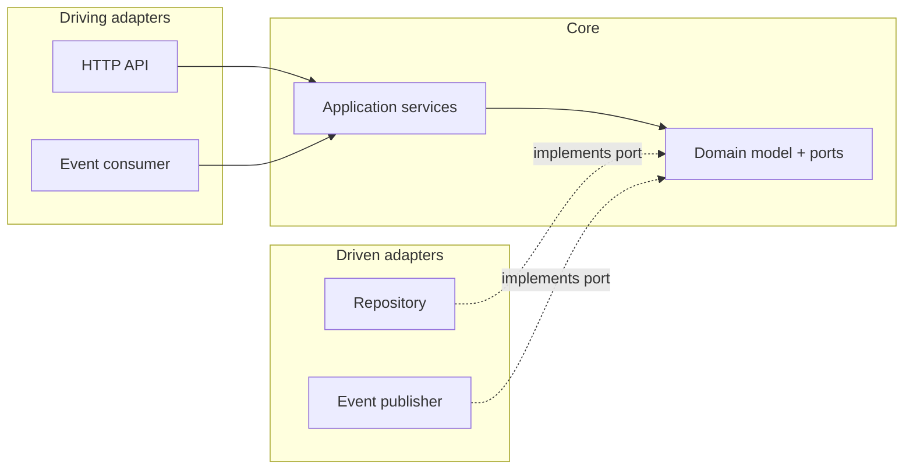

# Architecture — {{ project_name }}

> Project-owned. Keep diagrams in sync with the code (see `.ai/agents/11-documentation.md`).

## Overview

{{ architecture }}

A microservice owns one bounded context and its data. Justify the service boundary in an ADR
(`.ai/agents/04-architecture.md`): microservices are not the default.

## System architecture

```mermaid
flowchart LR
    gateway[API gateway / ingress] --> svc[{{ project_name }}]
    svc --> db[("{{ database_title }}")]
    svc -->|events| broker[[Message broker]]
    other[Other services] -->|HTTP / events| svc
```

## Hexagonal structure



## Contracts

TODO: link the OpenAPI specification and event schemas; they are versioned and backward
compatible (consumer-driven contract tests in `tests/contract`).

## Deployment

```mermaid
flowchart LR
    git[{{ org_git_server }}] --> ci[CI pipeline] --> registry[(Image registry)]
    registry --> staging[RKE Staging]
    staging -->|same image, after approval| prod[RKE Prod]
```

## Decisions

See `docs/adr/`.
